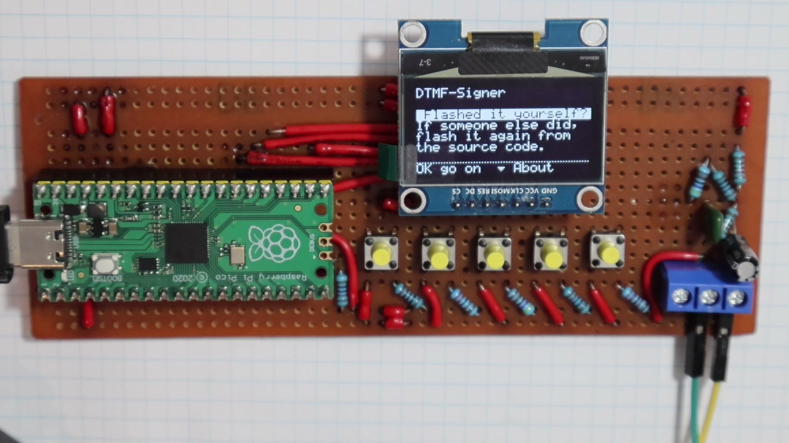
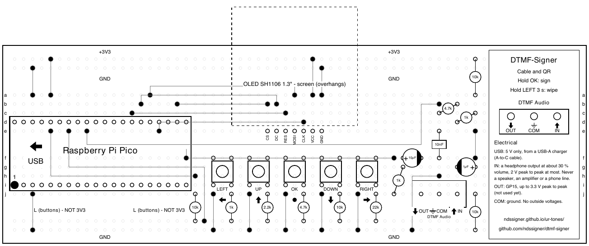
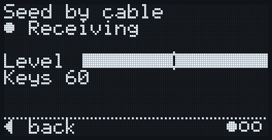
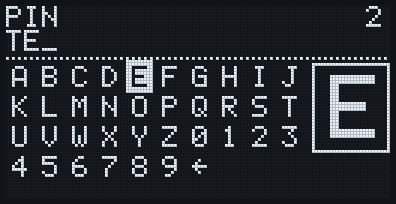
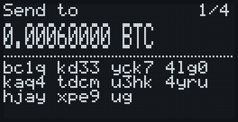
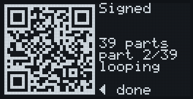
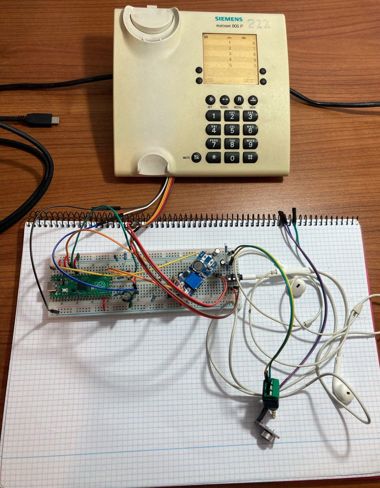
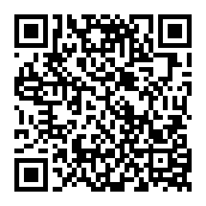

[English](README.md) · Español · [Web](https://ndssigner.github.io/dtmf-signer/)

*Traducción fiel del [README en inglés](README.md). Si difieren, manda la
versión inglesa.*

# DTMF-Signer

**Un firmador de Bitcoin que montas tú con piezas genéricas, así que ningún
revendedor tiene en sus manos un "aparato de Bitcoin" camino de tu casa.** Se
comunica con tu cartera mediante tonos de teléfono, y nunca muestra ni guarda
tu semilla.

[](https://odysee.com/@ndssigner:9/dtmf-signer-perfboard-v0-2-0:7)

**[▶ Míralo firmar una PSBT](https://odysee.com/@ndssigner:9/dtmf-signer-perfboard-v0-2-0:7)** (5 min), o pruébalo sin montar nada: el
[simulador](https://ndssigner.github.io/dtmf-signer/es/pex/) ejecuta el
firmware real en tu navegador, con una cartera de prueba.

| Montaje | Qué necesitas | Piezas | Estado |
| :--- | :--- | :--- | :--- |
| **Cable y QR** (la referencia) | Una Raspberry Pi Pico, una OLED de 1,3", cinco botones, una protoboard | unos 13–45 $ | Funciona: firma PSBT que Sparrow lee ([montaje](hardware/breadboard/README.es.md)) |
| **Centralita (PEX)** | Una Pico y cualquier teléfono de tonos de segunda mano: sin pantalla ni botones | unos 8–35 $ | Funciona en protoboard: lee cada salida en voz alta y firma cuando cuelgas ([montaje](hardware/phone/README.es.md)) |
| **Placa completa** | Una Pico 2, pantalla, botones, micrófono y piezo | | Prevista |

> **Prototipo que funciona, sin revisión independiente. No lo uses con fondos.**

**¿Por qué montártelo tú?** En 2026, dispositivos Ledger y Trezor vendidos
por un revendedor llevaban implantes ocultos que leían la semilla de la
pantalla, y un error en el firmware de Coldcard generó semillas débiles. Aquí
compras piezas genéricas en cualquier parte, grabas tú el microcontrolador, la
semilla no aparece en ninguna pantalla y el firmador no tiene generador de
números aleatorios que pueda fallar. [Más abajo](#motivación).

## Qué es

Un firmador de Bitcoin mínimo, barato y de hardware abierto que cualquiera
puede montar. La placa completa: una Raspberry Pi Pico, una pantalla pequeña,
cinco botones, un micrófono y un piezo; el montaje de referencia que ya
funciona, **Cable y QR**, prescinde del micrófono y del piezo: escucha por
cable y responde con códigos QR. El más barato, la **Centralita (PEX)**, no
tiene ni pantalla ni botones: un teléfono de tonos antiguo es toda su
interfaz. Se comunica con tu cartera mediante tonos de
teléfono (DTMF) a través de [ur-tones](https://github.com/ndssigner/ur-tones),
al aire o por cable. Sin cámara, sin elemento seguro y sin almacenamiento: la
semilla vive en memoria solo mientras firmas. Para usarlo se alimenta con un
cargador o una batería externa, nunca desde un ordenador. Del proyecto
[NDS-Signer](https://github.com/ndssigner/nds-signer).

**La idea central:** la semilla llega como tonos, creados con ur-tones en un
ordenador desconectado, y **nunca se muestra, por ningún canal**: solo su
huella. A partir de ahí, tú eliges: seguir todo por audio, para el máximo
aislamiento, o manejarlo desde un terminal vintage por un puerto serie.
DTMF-Signer y ur-tones están pensados para ir juntos.

**Muchas formas de montarlo.** DTMF-Signer es una
[especificación](docs/es/spec.md) que se puede montar de muchas
formas: desde una Raspberry Pi Pico, la referencia, hasta piezas
recuperadas de una chatarrería (un microcontrolador de 8 bits, un chip
decodificador DTMF de un teléfono viejo), sabiendo qué pierde cada montaje
y cuánto tarda. El [catálogo](docs/es/catalog.md) enumera las capacidades
y los perfiles que las combinan. El prototipo usa una Pico (RP2040); la
Pico 2 vendrá después.

## Estado

El montaje de referencia, Cable y QR,
funciona en una protoboard y en una placa perforada: carga una semilla por tonos con su PIN,
muestra las huellas, exporta la XPUB y devuelve las PSBT firmadas como
códigos QR que Sparrow lee. Su esquema (KiCad), su disposición y una
plantilla imprimible a escala 1:1 están en [`hardware/breadboard/`](hardware/breadboard/README.es.md).
Faltan los tonos por el aire (micrófono y altavoz), las PCB y una revisión
independiente. No lo uses con fondos. Vídeos: [en la protoboard](https://odysee.com/@ndssigner:9/demo-dtmf-signer:c)
y [en placa perforada con v0.2.0-alpha](https://odysee.com/@ndssigner:9/dtmf-signer-perfboard-v0-2-0:7).
La Centralita (PEX) también funciona en protoboard: carga una semilla por
el auricular o por el teclado, lee cada salida en voz alta y firma cuando
cuelgas un momento, byte a byte como la versión de ordenador
([su montaje](hardware/phone/README.es.md), con su esquema, su
disposición y una plantilla imprimible; la disposición separa las piezas
de la protoboard que se probó y no se ha montado tal cual). Falta su
placa perforada.

## Motivación

- **Un firmador para todos.** Funciona solo, con cualquier móvil u
  ordenador que pueda reproducir y oír sonido. Sin cámara, sin cables
  especiales, sin tiendas de aplicaciones.
- **Bajo coste.** Unos 13 $ en piezas para el montaje Cable y QR si las
  compras en lotes, como suelen hacer los aficionados; unos 45 $ comprando
  cada pieza suelta en una tienda. Los precios cambian mucho de un vendedor
  a otro ([las piezas y su coste](hardware/breadboard/README.es.md#piezas-y-coste)).
- **Hazlo tú mismo, fácil y a prueba de torpes.** Pincha una Pico en una
  placa ya montada, sin soldar, o conecta módulos comunes en una
  protoboard. Piezas genéricas que se compran en cualquier parte: la
  referencia decodifica los tonos por software, así que no necesita chips
  decodificadores de DTMF, difíciles de encontrar. Un montaje más lento
  puede usar uno recuperado de un teléfono viejo.
- **Frente a los ataques en la cadena de suministro y la entropía falsa.**
  - En octubre de 2026 se descubrió que aparatos Ledger vendidos por
    distribuidores llevaban un implante oculto que leía la frase de
    recuperación de la pantalla durante la configuración y la enviaba por
    la red móvil; las pérdidas se estiman en decenas de millones de dólares
    ([CoinDesk](https://www.coindesk.com/tech/2026/10/13/ledger-says-spy-chip-inside-cryptobilis-ledger-devices-transmitted-wallet-keys-over-mobile-network)).
    En noviembre, Trezor confirmó el mismo tipo de implante, adaptado a su
    pantalla, en unidades Safe 5 vendidas por el mismo distribuidor
    ([Trezor](https://trezor.io/blog/news/our-cryptobilis-investigation-what-we-found-and-what-weve-changed)).
    Aquí el firmador lo montas tú con piezas genéricas, el microcontrolador
    lo has comprado y flasheado tú y puedes sacarlo de su zócalo, y cada
    pieza de la placa está abierta y a la vista. Además, la semilla nunca
    se muestra en su pantalla: un implante que la leyera no encontraría
    nada que robar.
  - También en 2026, un error de compilación en el firmware de Coldcard le
    hizo generar semillas con un sustituto por software débil en lugar de
    su generador de números aleatorios por hardware, y las carteras creadas
    así fueron vaciadas
    ([crypto.news](https://crypto.news/coldcard-firmware-bug-drains-38-million-bitcoin/)).
    DTMF-Signer nunca genera semillas, y sus firmas usan nonces
    deterministas: no tiene ningún generador de números aleatorios que
    pueda fallar.

Además, **no tiene cajas negras** (ni cámara ni módulo QR con firmware
cerrado: todo el camino de la señal, del micrófono al decodificador, es
código propio) y **se lleva bien con las máquinas antiguas**: un ordenador
o una calculadora vintage le pueden prestar pantalla y teclado por un
puerto serie.

## Cómo funciona

```
  cartera + herramienta ur-tones        DTMF-Signer
 ┌──────────────────────┐   tonos   ┌───────────────────────┐
 │ PSBT sin firmar ─────┼─────────► │ micrófono → decodif.  │
 │                      │           │ pantalla + 5 botones  │
 │ PSBT firmada ◄───────┼───────────┤ piezo ← codificador   │
 └──────────────────────┘   tonos   └───────────────────────┘
```

1. La semilla llega como tonos, cifrada con un PIN. El PIN se teclea en el
   firmador y nunca suena. La passphrase, si usas una, llega por cable o se
   teclea en el firmador.
2. El firmador muestra la huella de la semilla, para comprobar que es la
   correcta. La semilla en sí nunca se muestra.
3. La PSBT sin firmar llega como tonos.
4. El firmador muestra en su pantalla cada salida, cada importe y la
   comisión. Las recorres todas y mantienes pulsado un botón para firmar.
5. La PSBT firmada vuelve como tonos.

Lo desenchufas y la semilla desaparece. Del paso 3 en adelante, las PSBT
pueden viajar como tonos o a través de un terminal vintage por el puerto
serie: tú eliges.

## Uso cotidiano

1. Genera la semilla fuera del firmador: con dados, o con otra cartera de
   tu confianza.
2. En un **ordenador desconectado**, la herramienta web de ur-tones la
   convierte en tonos, protegida con un **PIN de 12 caracteres o más**
   (puede generarlo por ti), y los guarda como archivo **WAV**.
3. Apunta el PIN en papel o guárdalo en un gestor de contraseñas, **siempre
   separado del WAV**.
4. Guarda el WAV en un **reproductor de audio sin conexión a internet**,
   como un reproductor MP3.
5. Para firmar: conecta el reproductor **por cable** al jack de entrada del
   firmador y reproduce el WAV. Teclea el PIN en el firmador y comprueba la
   huella.
6. Después, firma: las PSBT van y vienen por el aire con tu cartera, o a
   través de un terminal vintage.

El WAV es una copia cifrada de tu semilla: quien lo consiga puede probar
PINs sin conexión, así que usa un PIN largo. Y **no debe ser tu única copia
de seguridad**: los reproductores se estropean. Guarda también la semilla
por otra vía (papel, metal, [SeedCraft](https://github.com/ndssigner/seedcraft)…).

## El montaje de referencia: Cable y QR



Lo que ya funciona, en una protoboard de tamaño completo
([disposición y plantilla](hardware/breadboard/README.es.md)):

| Pieza | Para qué |
|---|---|
| Raspberry Pi Pico (RP2040) | El microcontrolador. La compras y la flasheas tú |
| OLED SH1106 de 1,3", 128 × 64, por SPI | Revisar lo que firmas, introducir PIN y passphrase, mostrar códigos QR |
| Cinco botones en un pin del ADC | Moverse, teclear, confirmar |
| Bornera de audio (IN, COM, OUT) | Tonos por cable desde un móvil o un ordenador, con un cable de auriculares |

Escucha por cable y habla por QR: la semilla y las PSBT entran como tonos,
y la XPUB y las PSBT firmadas salen como códigos QR animados en su
pantalla. Una docena de resistencias y condensadores lo completan.

**Aliméntalo siempre con un cargador USB o una batería externa, nunca desde
un ordenador.** El firmador nunca lee de su puerto USB, pero el firmware de
este prototipo escribe en él un eco público (la XPUB, las huellas, las PSBT
firmadas; nunca la semilla, el PIN ni la passphrase), así que un ordenador al
otro lado sabría qué cartera es. Una versión sin eco está pendiente. Solo se
conecta a un ordenador para grabarlo, en modo BOOTSEL y sin semilla cargada.
Un cargador USB-A con un cable USB-A a USB-C es el que funciona siempre
([alimentación](ports/pico/README.es.md#alimentación)).

|  |  |
| :---: | :---: |
| Escuchando, con el medidor de nivel | El PIN, con su lupa |
|  |  |
| Cada salida: importe y dirección completa | La PSBT firmada, como QR |

Todas las pantallas y cómo se navega por ellas: [las pantallas](docs/es/screens.md)
(dibujadas por el propio código del firmware).

Para grabar la Pico, toma el UF2 adjunto a una versión y cópialo en la Pico
en modo BOOTSEL, o compílalo tú con `tools/build-pico.sh`; compilado en
Linux x86_64, como el publicado, da el mismo archivo byte a byte
([cómo](ports/pico/README.es.md#conseguir-el-firmware)).

## El montaje más barato: Centralita (PEX)

Sin pantalla ni botones: un teléfono de tonos, con su auricular, enchufado a
un conector RJ11 de la placa, es toda la interfaz. El firmador alimenta la
línea del teléfono, como una centralita, te habla por el auricular y oye tus
teclas, y los tonos de tu cartera le llegan por el micrófono del auricular
([el montaje en protoboard](hardware/phone/README.es.md)):



| Pieza | Para qué |
|---|---|
| Raspberry Pi Pico (RP2040) | El microcontrolador. La compras y la flasheas tú (`DS_FIRMWARE=PEX`) |
| Un teléfono de tonos con su auricular | Teclado, auricular y micrófono: toda la interfaz. Cualquiera de segunda mano |
| Conector RJ11 | Donde se enchufa el teléfono |
| Módulo elevador de 5 a 12 V y un LM317 | Alimentación de la línea del teléfono desde el USB, unos 24 mA |

Una docena de resistencias y condensadores lo completan. Lee en voz alta
cada salida de una transacción, el cambio y la comisión, y solo firma cuando
cuelgas un momento y vuelves a descolgar: ninguna tecla puede firmar. Habla
inglés, y otros idiomas como paquetes aparte (hoy, español). Mientras el
auricular está pegado a la cartera, el LED de la Pico enseña cómo va la
recepción. Pruébalo antes en el
[simulador](https://ndssigner.github.io/dtmf-signer/es/pex/).

## La placa completa (prevista)

| Pieza | Para qué |
|---|---|
| Raspberry Pi Pico 2 en zócalo | El microcontrolador. La compras y la flasheas tú |
| OLED de 1,3", 128 × 64 | Revisar lo que firmas, introducir PIN y passphrase |
| Cruceta de 5 botones | Moverse, teclear, confirmar |
| Micrófono y piezo | Tonos por el aire |
| Jack de audio solo de entrada | Un canal por cable para los datos sensibles |
| USB-C solo de alimentación | Sin ninguna línea de datos |

Los puertos opcionales vienen como **huellas sin montar**, para quien los
quiera: serie RS-232 o TTL, teclado PS/2, vídeo compuesto en blanco y negro,
salida de línea, pilas y una tira con los GPIO libres.

## Seguridad en resumen

- **La semilla nunca se muestra.** Ni en la pantalla, ni por la salida de
  vídeo, ni por el puerto serie, ni por audio. Solo su huella.
- **Sin estado.** La semilla vive solo en memoria. Nada se escribe en la
  flash. Desenchufarlo o apagarlo la borra, igual que el borrado de
  emergencia (mantener IZQUIERDA 3 s).
- **El PIN y la passphrase nunca van por el aire.** Los datos sensibles
  llegan por cable o se teclean en el firmador, y nunca salen de él, por
  ningún canal.
- **Lo revisas en el firmador.** Cada salida se muestra en su propia
  pantalla, y nada se firma sin su botón físico.
- **Ningún generador de números aleatorios que pueda fallar.** Las firmas
  usan nonces deterministas (RFC 6979).
- **Sin elemento seguro, a propósito.** Apagado, no hay nada que extraer.
- **Comprar te vincula a Bitcoin.** Cualquier pedido de una placa montada
  deja tu nombre y tu dirección en la base de datos de alguien. Las piezas
  genéricas compradas por separado para la versión en protoboard son el
  camino más privado.

El análisis completo, por formato de distribución y por uso, está en
[el análisis de riesgos](docs/es/risk-analysis.md).

## Formas de montarlo

- **Protoboard** (disponible: la [disposición](hardware/breadboard/README.es.md)),
  con módulos comerciales comunes.
- **Placa perforada** (disponible: la misma disposición y su plantilla
  imprimible 1:1; montada y funcionando con v0.2.0-alpha, [vídeo](https://odysee.com/@ndssigner:9/dtmf-signer-perfboard-v0-2-0:7)): los mismos módulos soldados en una placa de prototipos con
  el trazado de una protoboard, con la Pico y la pantalla en tiras hembra. El
  montaje de la protoboard se pasa tal cual. Más sólida y portátil, sin pedir
  ninguna PCB.
- **PCB "shell"** (prevista): montada en fábrica, sin la Pico ni la pantalla. Las
  compras tú, flasheas la Pico y las pinchas.
- **La misma PCB con la Pico y la pantalla en sus zócalos**, la Pico sin
  flashear, por comodidad. Reflashéala antes de usarla.
- **Una PCB de agujero pasante** para pedirla vacía y soldarla a mano.

La Centralita (PEX) está de momento en protoboard
([su montaje](hardware/phone/README.es.md)); faltan sus archivos de
disposición y la placa perforada.

## Hoja de ruta

- [x] Especificación independiente del hardware y catálogo de capacidades
- [x] Núcleo: de la semilla a las huellas y la XPUB, y una versión para ordenador (`ports/host`)
- [x] Firmware del núcleo, probado con grabaciones de ur-tones
- [x] Decodificador de tonos por software en la referencia Pico, probado con ur-tones
- [x] Disposición en protoboard (DIY Layout Creator), comprobada por sus conexiones, y una plantilla imprimible 1:1 para la placa perforada
- [x] Esquemas en KiCad y listas de materiales de los dos montajes
- [ ] Guía de montaje paso a paso para Cable y QR (la de la Centralita comprueba cada paso)
- [ ] Dos diseños de PCB: SMD (montada en fábrica) y de agujero pasante
- [x] El firmware en el navegador: `ports/wasm`, el simulador de la [web](https://ndssigner.github.io/dtmf-signer/), con una wallet de prueba
- [ ] Simulación de las etapas analógicas
- [x] Núcleo y versión para ordenador: análisis de PSBT, firma y sesión de firma (`ports/host`)
- [x] Firmware para la Pico (`ports/pico`): audio, ur-tones, PSBT, firma, pantallas. Probado en el prototipo de protoboard: semilla por tonos con su PIN, huellas, la XPUB como QR leído por Sparrow, dos PSBT firmadas byte a byte igual que la versión para ordenador, un cambio falso rechazado y el borrado de emergencia. En la placa perforada, v0.2.0-alpha desde la semilla por tonos hasta la PSBT firmada leída por Sparrow
- [x] La Centralita (PEX), el firmware de voz (`app/ds_voice`): en el simulador de la web, y en la Pico (`DS_FIRMWARE=PEX`). Probada en protoboard: los menús, la semilla por el teclado y por el auricular con su PIN, la revisión en voz alta, la firma por un colgado corto byte a byte como la versión de ordenador, la cuenta leída por ur-tones
- [x] La disposición de la Centralita en DIY Layout Creator, comprobada por sus conexiones, y una plantilla imprimible 1:1
- [ ] La Centralita montada a partir de esa disposición, y su placa perforada
- [ ] Protocolo serie para terminales vintage
- [ ] Guía de portabilidad: una invitación a otras plataformas
- [ ] Revisión independiente

## Aviso

DTMF-Signer es un diseño experimental y se ofrece tal cual, sin ninguna
garantía. El firmware solo está probado en prototipos de protoboard y de placa perforada, no
es para fondos reales, y nadie independiente lo ha revisado. No respondemos de pérdidas de fondos ni de
ningún otro daño, ni del uso que cada cual haga de este diseño.

## Qué hay en el repositorio

- [`SPEC.md`](SPEC.md) ([en español](docs/es/spec.md)): la
  especificación: lo que debe hacer todo montaje, esté hecho de lo que esté
  hecho.
- [`docs/catalog.md`](docs/catalog.md) ([en español](docs/es/catalog.md)):
  las capacidades y los perfiles que las combinan.
- [`docs/minimal-hardware.md`](docs/es/minimal-hardware.md): la especificación de
  hardware de la placa Pico completa: pines, audio, pantallas, formatos de
  distribución.
- [Las pantallas](docs/es/screens.md) ([inglés](docs/screens.md)): cómo se
  ve la versión de la Pico en su OLED de 128 × 64 y cómo se navega, con
  imágenes de cada pantalla.
- [Análisis de riesgos](docs/es/risk-analysis.md) ([inglés](docs/risk-analysis.md)):
  cadena de suministro, privacidad del comprador, firmware, uso y
  amenazas físicas.
- [`core/`](core/): el núcleo portable en C99: SHA-512, HMAC, PBKDF2, BIP39,
  BIP32 y la cartera BIP84, de una semilla a sus huellas y su XPUB; el análisis
  y la firma de PSBT, la política de canales y la sesión.
- [`ports/host/`](ports/host/): la versión para ordenador,
  `dtmf-signer-host keys`: de un UR, tonos o un WAV a las huellas, la XPUB y
  el descriptor; y `dtmf-signer-host sign`: una PSBT (base64, binaria, un
  UR o un WAV con sus tonos) de entrada, el resumen por la salida de error,
  "yes" por la entrada estándar y la PSBT firmada de salida.
  `dtmf-signer-host tones seed|psbt … --out FILE.wav` es una herramienta de
  pruebas que graba una semilla o una PSBT como tonos (ritmo de cable, de
  cable rápido o de aire; las semillas en modo teclado, `--keypad`, van
  siempre a ritmo de aire, 80/80/600 ms, porque ur-tones pide ahí al menos
  80 ms + 80 ms, y con ellas se rechaza cualquier otro `--timing`). Aviso: sus argumentos (semilla, PIN, frase de paso) los ven
  otros procesos y quedan en el historial del shell; usa solo semillas de
  prueba con ella.
- [`ports/pico/`](ports/pico/): el firmware para la Raspberry Pi Pico
  (RP2040), un proyecto CMake propio:
  `cmake -S ports/pico -B build-pico -DPICO_SDK_PATH=<pico-sdk>`
  da `dtmf-signer-pico.uf2`. Línea en GP27,
  botones en una escalera de resistencias en GP28, una OLED SH1106 por SPI
  (los pines, en `board.h`). `-DDS_DISPLAY=SSD1306_SPI` y `SSD1306_I2C`
  compilan para la SSD1306 pero no están probadas en hardware;
  la pantalla va girada 180 grados por defecto, como la monta la disposición en
  protoboard (`-DDS_DISPLAY_FLIP=OFF` para el otro sentido). El serie USB es solo de salida (el
  eco público y `stack-free`). Con `-DDS_FIRMWARE=PEX` compila en su lugar la
  Centralita, `dtmf-signer-pex.uf2`. Ver el [README de la Pico](ports/pico/README.es.md).
- [`ports/wasm/`](ports/wasm/README.es.md): el mismo firmware como
  WebAssembly, la placa del simulador de la web. `tools/build-wasm.sh` lo
  compila con Emscripten en Docker, fijado por digest: el mismo commit da el
  mismo archivo.
- [`site/`](site/TRANSLATING.md): la web, construida sin dependencias
  (`node site/build.mjs`) y publicada en GitHub Pages; sus textos se pueden
  traducir a cualquier idioma.
- [`hardware/breadboard/`](hardware/breadboard/README.es.md): la disposición
  en protoboard del montaje de referencia (DIY Layout Creator, CERN-OHL-S v2)
  y sus plantillas imprimibles 1:1. `tools/check_diy.py` lee la disposición y
  muestra qué conecta cada pieza; `tools/breadboard_template.py` genera las
  plantillas.
- [`hardware/phone/`](hardware/phone/README.es.md): la Centralita (PEX) en
  protoboard: su circuito, su lista de piezas y cómo montarla y comprobarla
  paso a paso.
- [`vectors/`](vectors/): vectores de prueba (JSON), solo semillas de prueba
  públicas: claves y PSBT.
- [`CONTRIBUTING.md`](CONTRIBUTING.md): cómo proponer cambios, ampliar el
  catálogo o portar DTMF-Signer (en inglés). Se busca: un [paquete de voz en
  tu idioma](docs/es/voice-packs.md) para la Centralita.
- [`AUDIT.md`](AUDIT.md): un mapa para revisores: los ficheros críticos por
  prioridad, las dependencias fijadas y las carencias conocidas.
  [`SECURITY.md`](SECURITY.md): cómo avisar en privado de una
  vulnerabilidad. [`THIRD_PARTY.md`](THIRD_PARTY.md): el código de terceros
  y sus licencias. [`CHANGELOG.md`](CHANGELOG.md): qué ha cambiado. Los
  cuatro, en inglés.

## Cómo empezó

La culpa es de una canción pop. En ["Catch Catch"](https://www.youtube.com/watch?v=NOiyDlWl534),
la cantante de K-pop Yena usa los pitidos del teclado de un teléfono como
parte de la música. En algún momento entre el segundo estribillo y la
tercera escucha seguida surgió una pregunta muy poco musical: si una
canción puede llevar DTMF, ¿por qué no una transacción de Bitcoin? Súmale
el recién terminado [NDS-Signer](https://github.com/ndssigner/nds-signer),
que acababa de enseñar a firmar a una Nintendo DSi, y DTMF-Signer era el
paso obvio. Así que sí: este firmador existe porque alguien no podía dejar
de escuchar una canción. Sin arrepentimientos.

## Proyectos hermanos

- [NDS-Signer](https://github.com/ndssigner/nds-signer): un firmador sin
  conexión para la Nintendo DSi, que firma PSBT por QR o por tonos.
- [ur-tones](https://github.com/ndssigner/ur-tones): PSBT y semillas como
  tonos de teléfono, por cable o al aire.
- [SeedCraft](https://github.com/ndssigner/seedcraft): una semilla guardada
  como el orden de unos objetos, que se vuelve a leer a mano o con una
  herramienta web.

## Apoyar el proyecto

DTMF-Signer es gratuito y no tiene financiación. Las donaciones ayudan a
mantenerlo:

<table>
<tr><td align="center"><br><b>Bitcoin</b><br><code>bc1qx5snc0wlc8cg9gwxhyx27y6pkru8rnngyq7uja</code></td>
<td align="center"><br><b>Lightning</b><br><code>ndssigner@coinos.io</code></td></tr>
</table>

<sub>Las carteras Lightning sin direcciones Lightning pueden usar el LNURL:<br><code>LNURL1DP68GURN8GHJ7CM0D9HX7UEWD9HJ7TNHV4KXCTTTDEHHWM30D3H82UNVWQHKUERNWD5KWMN9WGQ8XE42</code></sub>

Las mismas direcciones que [NDS-Signer](https://github.com/ndssigner/nds-signer#donate).

## Licencia

- **Software** (el núcleo, `app/`, los ports, las herramientas y las
  pruebas) y su documentación: la [licencia MIT](LICENSE).
- **Hardware** (circuitos, disposiciones de placa, plantillas imprimibles y,
  más adelante, diseños de PCB, como
  [la disposición en protoboard](hardware/breadboard/README.es.md) y
  [docs/es/minimal-hardware.md](docs/es/minimal-hardware.md)): la
  [CERN-OHL-S v2](LICENSE-HARDWARE), una licencia de hardware abierto de
  reciprocidad fuerte. Quien fabrique y distribuya un diseño modificado debe
  publicar también sus fuentes.

Las partes de terceros conservan sus propias condiciones: libsecp256k1 y
qrcodegen (en `third_party/`) están bajo la licencia MIT, y
`ports/pico/pico_sdk_import.cmake` procede del SDK de la Raspberry Pi Pico
(BSD de 3 cláusulas). La fuente 5×7 de la pantalla (`app/ds_font5x7.h`) no
es un dibujo original: sus glifos (0x20–0x7E) son el diseño clásico de
generador de caracteres 5×7, ampliamente publicado.
