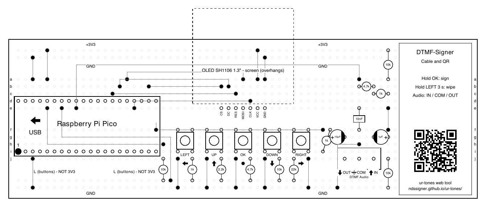

[English](README.md) · Español

*Traducción fiel del [README en inglés](README.md). Si difieren, manda la
versión inglesa.*

# DTMF-Signer

Un firmador de Bitcoin mínimo, barato y de hardware abierto que cualquiera
puede montar. La placa completa: una Raspberry Pi Pico, una pantalla pequeña,
cinco botones, un micrófono y un piezo; el montaje de referencia que ya
funciona, **Cable y QR**, prescinde del micrófono y del piezo: escucha por
cable y responde con códigos QR. Se comunica con tu cartera mediante tonos de
teléfono (DTMF) a través de [ur-tones](https://github.com/ndssigner/ur-tones),
al aire o por cable. Sin cámara, sin datos por USB, sin elemento seguro y sin
almacenamiento: la semilla vive en memoria solo mientras firmas. Del proyecto
[NDS-Signer](https://github.com/ndssigner/nds-signer).

**La idea central:** la semilla llega como tonos, creados con ur-tones en un
ordenador desconectado, y **nunca se muestra, por ningún canal**: solo su
huella. A partir de ahí, tú eliges: seguir todo por audio, para el máximo
aislamiento, o manejarlo desde un terminal vintage por un puerto serie.
DTMF-Signer y ur-tones están pensados para ir juntos.

**Muchas formas de montarlo.** DTMF-Signer es una
[especificación](docs/es/especificacion.md) que se puede montar de muchas
formas: desde una Raspberry Pi Pico, la referencia, hasta piezas
recuperadas de una chatarrería (un microcontrolador de 8 bits, un chip
decodificador DTMF de un teléfono viejo), sabiendo qué pierde cada montaje
y cuánto tarda. El [catálogo](docs/es/catalogo.md) enumera las capacidades
y los perfiles que las combinan. El prototipo usa una Pico (RP2040); la
Pico 2 vendrá después.

> **Estado: prototipo que funciona.** El montaje de referencia, Cable y QR,
> funciona en una protoboard: carga una semilla por tonos con su PIN,
> muestra las huellas, exporta la XPUB y devuelve las PSBT firmadas como
> códigos QR que Sparrow lee. Su disposición y una plantilla imprimible a
> escala 1:1 están en [`hardware/breadboard/`](hardware/breadboard/README.es.md).
> Faltan los tonos por el aire (micrófono y altavoz), las PCB y una revisión
> independiente. No lo uses con fondos.

## Motivación

- **Un firmador para todos.** Funciona solo, con cualquier móvil u
  ordenador que pueda reproducir y oír sonido. Sin cámara, sin cables
  especiales, sin tiendas de aplicaciones.
- **Bajo coste.** Unos 13 $ en piezas para la placa básica (una
  estimación), más o menos un tercio de un firmador que lee códigos QR con
  un módulo lector.
- **Hazlo tú mismo, fácil y a prueba de torpes.** Pincha una Pico en una
  placa ya montada, sin soldar, o conecta módulos comunes en una
  protoboard. Piezas genéricas que se compran en cualquier parte: la
  referencia decodifica los tonos por software, así que no necesita chips
  decodificadores de DTMF, difíciles de encontrar. Un montaje más lento
  puede usar uno recuperado de un teléfono viejo.
- **Frente a los ataques en la cadena de suministro y la entropía falsa.**
  - En octubre de 2026 se descubrió que aparatos Ledger vendidos por
    distribuidores llevaban un implante oculto que leía la frase de
    recuperación de la pantalla durante la configuración y la enviaba por
    la red móvil; las pérdidas se estiman en decenas de millones de dólares
    ([CoinDesk](https://www.coindesk.com/tech/2026/10/13/ledger-says-spy-chip-inside-cryptobilis-ledger-devices-transmitted-wallet-keys-over-mobile-network)).
    Aquí el firmador lo montas tú con piezas genéricas, el microcontrolador
    lo has comprado y flasheado tú y puedes sacarlo de su zócalo, y cada
    pieza de la placa está abierta y a la vista. Además, la semilla nunca
    se muestra en su pantalla: un implante que la leyera no encontraría
    nada que robar.
  - También en 2026, un error de compilación en el firmware de Coldcard le
    hizo generar semillas con un sustituto por software débil en lugar de
    su generador de números aleatorios por hardware, y las carteras creadas
    así fueron vaciadas
    ([crypto.news](https://crypto.news/coldcard-firmware-bug-drains-38-million-bitcoin/)).
    DTMF-Signer nunca genera semillas, y sus firmas usan nonces
    deterministas: no tiene ningún generador de números aleatorios que
    pueda fallar.

Además, **no tiene cajas negras** (ni cámara ni módulo QR con firmware
cerrado: todo el camino de la señal, del micrófono al decodificador, es
código propio) y **se lleva bien con las máquinas antiguas**: un ordenador
o una calculadora vintage le pueden prestar pantalla y teclado por un
puerto serie.

## Cómo funciona

```
  cartera + herramienta ur-tones        DTMF-Signer
 ┌──────────────────────┐   tonos   ┌───────────────────────┐
 │ PSBT sin firmar ─────┼─────────► │ micrófono → decodif.  │
 │                      │           │ pantalla + 5 botones  │
 │ PSBT firmada ◄───────┼───────────┤ piezo ← codificador   │
 └──────────────────────┘   tonos   └───────────────────────┘
```

1. La semilla llega como tonos, cifrada con un PIN. El PIN se teclea en el
   firmador y nunca suena. La passphrase, si usas una, llega por cable o se
   teclea en el firmador.
2. El firmador muestra la huella de la semilla, para comprobar que es la
   correcta. La semilla en sí nunca se muestra.
3. La PSBT sin firmar llega como tonos.
4. El firmador muestra en su pantalla cada salida, cada importe y la
   comisión. Las recorres todas y mantienes pulsado un botón para firmar.
5. La PSBT firmada vuelve como tonos.

Lo desenchufas y la semilla desaparece. Del paso 3 en adelante, las PSBT
pueden viajar como tonos o a través de un terminal vintage por el puerto
serie: tú eliges.

## Uso cotidiano

1. Genera la semilla fuera del firmador: con dados, o con otra cartera de
   tu confianza.
2. En un **ordenador desconectado**, la herramienta web de ur-tones la
   convierte en tonos, protegida con un **PIN de 12 caracteres o más**
   (puede generarlo por ti), y los guarda como archivo **WAV**.
3. Apunta el PIN en papel o guárdalo en un gestor de contraseñas, **siempre
   separado del WAV**.
4. Guarda el WAV en un **reproductor de audio sin conexión a internet**,
   como un reproductor MP3.
5. Para firmar: conecta el reproductor **por cable** al jack de entrada del
   firmador y reproduce el WAV. Teclea el PIN en el firmador y comprueba la
   huella.
6. Después, firma: las PSBT van y vienen por el aire con tu cartera, o a
   través de un terminal vintage.

El WAV es una copia cifrada de tu semilla: quien lo consiga puede probar
PINs sin conexión, así que usa un PIN largo. Y **no debe ser tu única copia
de seguridad**: los reproductores se estropean. Guarda también la semilla
por otra vía (papel, metal, [SeedCraft](https://github.com/ndssigner/seedcraft)…).

## El montaje de referencia: Cable y QR



Lo que ya funciona, en una protoboard de tamaño completo
([disposición y plantilla](hardware/breadboard/README.es.md)):

| Pieza | Para qué |
|---|---|
| Raspberry Pi Pico (RP2040) | El microcontrolador. La compras y la flasheas tú |
| OLED SH1106 de 1,3", 128 × 64, por SPI | Revisar lo que firmas, introducir PIN y passphrase, mostrar códigos QR |
| Cinco botones en un pin del ADC | Moverse, teclear, confirmar |
| Bornera de audio (IN, COM, OUT) | Tonos por cable desde un móvil o un ordenador, con un cable de auriculares |

Escucha por cable y habla por QR: la semilla y las PSBT entran como tonos,
y la XPUB y las PSBT firmadas salen como códigos QR animados en su
pantalla. Una docena de resistencias y condensadores lo completan.

## La placa completa (prevista)

| Pieza | Para qué |
|---|---|
| Raspberry Pi Pico 2 en zócalo | El microcontrolador. La compras y la flasheas tú |
| OLED de 1,3", 128 × 64 | Revisar lo que firmas, introducir PIN y passphrase |
| Cruceta de 5 botones | Moverse, teclear, confirmar |
| Micrófono y piezo | Tonos por el aire |
| Jack de audio solo de entrada | Un canal por cable para los datos sensibles |
| USB-C solo de alimentación | Sin ninguna línea de datos |

Los puertos opcionales vienen como **huellas sin montar**, para quien los
quiera: serie RS-232 o TTL, teclado PS/2, vídeo compuesto en blanco y negro,
salida de línea, pilas y una tira con los GPIO libres.

## Seguridad en resumen

- **La semilla nunca se muestra.** Ni en la pantalla, ni por la salida de
  vídeo, ni por el puerto serie, ni por audio. Solo su huella.
- **Sin estado.** La semilla vive solo en memoria. Nada se escribe en la
  flash. Desenchufarlo, apagarlo o dejarlo inactivo la borra.
- **El PIN y la passphrase nunca van por el aire.** Los datos sensibles
  llegan por cable o se teclean en el firmador, y nunca salen de él, por
  ningún canal.
- **Lo revisas en el firmador.** Cada salida se muestra en su propia
  pantalla, y nada se firma sin su botón físico.
- **Ningún generador de números aleatorios que pueda fallar.** Las firmas
  usan nonces deterministas (RFC 6979, BIP 340).
- **Sin elemento seguro, a propósito.** Apagado, no hay nada que extraer.
- **Comprar te vincula a Bitcoin.** Cualquier pedido de una placa montada
  deja tu nombre y tu dirección en la base de datos de alguien. Las piezas
  genéricas compradas por separado para la versión en protoboard son el
  camino más privado.

El análisis completo, por formato de distribución y por uso, está en
[`docs/analisis-riesgos.md`](docs/analisis-riesgos.md).

## Formas de montarlo

- **Protoboard** (disponible: la [disposición](hardware/breadboard/README.es.md)),
  con módulos comerciales comunes.
- **Placa perforada** (disponible: la misma disposición y su plantilla
  imprimible 1:1): los mismos módulos soldados en una placa de prototipos con
  el trazado de una protoboard, con la Pico y la pantalla en tiras hembra. El
  montaje de la protoboard se pasa tal cual. Más sólida y portátil, sin pedir
  ninguna PCB.
- **PCB "shell"** (prevista): montada en fábrica, sin la Pico ni la pantalla. Las
  compras tú, flasheas la Pico y las pinchas.
- **La misma PCB con la Pico y la pantalla en sus zócalos**, la Pico sin
  flashear, por comodidad. Reflashéala antes de usarla.
- **Una PCB de agujero pasante** para pedirla vacía y soldarla a mano.

## Hoja de ruta

- [x] Especificación independiente del hardware y catálogo de capacidades
- [x] Núcleo: de la semilla a las huellas y la XPUB, y una versión para ordenador (`ports/host`)
- [x] Firmware del núcleo, probado con grabaciones de ur-tones
- [x] Decodificador de tonos por software en la referencia Pico, probado con ur-tones
- [x] Disposición en protoboard (DIY Layout Creator), comprobada por sus conexiones, y una plantilla imprimible 1:1 para la placa perforada
- [ ] Esquema, guía de montaje paso a paso y lista de materiales
- [ ] Dos diseños de PCB: SMD (montada en fábrica) y de agujero pasante
- [ ] Simulación de las etapas analógicas y del firmware
- [x] Núcleo y versión para ordenador: análisis de PSBT, firma y sesión de firma (`ports/host`)
- [x] Firmware para la Pico (`ports/pico`): audio, ur-tones, PSBT, firma, pantallas. Probado en el prototipo de protoboard: semilla por tonos con su PIN, huellas, la XPUB como QR leído por Sparrow, dos PSBT firmadas byte a byte igual que la versión para ordenador, un cambio falso rechazado y el borrado de emergencia
- [ ] Protocolo serie para terminales vintage
- [ ] Guía de portabilidad: una invitación a otras plataformas
- [ ] Revisión independiente

## Aviso

DTMF-Signer es un diseño experimental y se ofrece tal cual, sin ninguna
garantía. El firmware solo está probado en un prototipo de protoboard, no
es para fondos reales, y nadie independiente lo ha revisado. No respondemos de pérdidas de fondos ni de
ningún otro daño, ni del uso que cada cual haga de este diseño.

## Qué hay en el repositorio

- [`SPEC.md`](SPEC.md) ([en español](docs/es/especificacion.md)): la
  especificación: lo que debe hacer todo montaje, esté hecho de lo que esté
  hecho.
- [`docs/catalog.md`](docs/catalog.md) ([en español](docs/es/catalogo.md)):
  las capacidades y los perfiles que las combinan.
- [`docs/hardware-minimo.md`](docs/hardware-minimo.md): la especificación de
  hardware de la placa Pico completa: pines, audio, pantallas, formatos de
  distribución.
- [`docs/analisis-riesgos.md`](docs/analisis-riesgos.md): el análisis de
  riesgos: cadena de suministro, privacidad del comprador, firmware, uso y
  amenazas físicas.
- [`core/`](core/): el núcleo portable en C99: SHA-512, HMAC, PBKDF2, BIP39,
  BIP32 y la cartera BIP84, de una semilla a sus huellas y su XPUB; el análisis
  y la firma de PSBT, la política de canales y la sesión.
- [`ports/host/`](ports/host/): la versión para ordenador,
  `dtmf-signer-host keys`: de un UR, tonos o un WAV a las huellas, la XPUB y
  el descriptor; y `dtmf-signer-host sign`: una PSBT (base64, binaria, un
  UR o un WAV con sus tonos) de entrada, el resumen por la salida de error,
  "yes" por la entrada estándar y la PSBT firmada de salida.
  `dtmf-signer-host tones seed|psbt … --out FILE.wav` es una herramienta de
  pruebas que graba una semilla o una PSBT como tonos (ritmo de cable o de
  aire; las semillas en modo teclado, `--keypad`, van siempre a ritmo de
  aire, 80/80/600 ms, porque ur-tones pide ahí al menos 80 ms + 80 ms, y
  con ellas se rechaza `--timing cable`). Aviso: sus argumentos (semilla, PIN, frase de paso) los ven
  otros procesos y quedan en el historial del shell; usa solo semillas de
  prueba con ella.
- [`ports/pico/`](ports/pico/): el firmware para la Raspberry Pi Pico
  (RP2040), un proyecto CMake propio:
  `cmake -S ports/pico -B build-pico -DPICO_SDK_PATH=<pico-sdk>`
  da `dtmf-signer-pico.uf2`. Línea en GP27,
  botones en una escalera de resistencias en GP28, una OLED SH1106 por SPI
  (los pines, en `board.h`). `-DDS_DISPLAY=SSD1306_SPI` y `SSD1306_I2C`
  compilan para la SSD1306 pero no están probadas en hardware;
  `-DDS_DISPLAY_FLIP=ON` gira la pantalla. El serie USB es solo de salida (el
  eco público y `stack-free`). Ver el [README de la Pico](ports/pico/README.es.md).
- [`hardware/breadboard/`](hardware/breadboard/README.es.md): la disposición
  en protoboard del montaje de referencia (DIY Layout Creator, CERN-OHL-S v2)
  y sus plantillas imprimibles 1:1. `tools/check_diy.py` lee la disposición y
  muestra qué conecta cada pieza; `tools/breadboard_template.py` genera las
  plantillas.
- [`vectors/`](vectors/): vectores de prueba (JSON), solo semillas de prueba
  públicas: claves y PSBT.
- [`CONTRIBUTING.md`](CONTRIBUTING.md): cómo proponer cambios, ampliar el
  catálogo o portar DTMF-Signer (en inglés).

## Proyectos hermanos

- [NDS-Signer](https://github.com/ndssigner/nds-signer): un firmador sin
  conexión para la Nintendo DSi, que firma PSBT por QR o por tonos.
- [ur-tones](https://github.com/ndssigner/ur-tones): PSBT y semillas como
  tonos de teléfono, por cable o al aire.
- [SeedCraft](https://github.com/ndssigner/seedcraft): una semilla guardada
  como el orden de unos objetos, que se vuelve a leer a mano o con una
  herramienta web.

## Apoyar el proyecto

DTMF-Signer es gratuito y no tiene financiación. Las donaciones ayudan a
mantenerlo:

<table>
<tr><td align="center"><br><b>Bitcoin</b><br><code>bc1qx5snc0wlc8cg9gwxhyx27y6pkru8rnngyq7uja</code></td>
<td align="center"><br><b>Lightning</b><br><code>ndssigner@coinos.io</code><br><sub>LNURL (para carteras sin direcciones Lightning):<br><code>LNURL1DP68GURN8GHJ7CM0D9HX7UEWD9HJ7TNHV4KXCTTTDEHHWM30D3H82UNVWQHKUERNWD5KWMN9WGQ8XE42</code></sub></td></tr>
</table>

Las mismas direcciones que [NDS-Signer](https://github.com/ndssigner/nds-signer#donate).

## Licencia

- **Software** (el núcleo, `app/`, los ports, las herramientas y las
  pruebas) y su documentación: la [licencia MIT](LICENSE).
- **Hardware** (circuitos, disposiciones de placa, plantillas imprimibles y,
  más adelante, diseños de PCB, como
  [la disposición en protoboard](hardware/breadboard/README.es.md) y
  [docs/hardware-minimo.md](docs/hardware-minimo.md)): la
  [CERN-OHL-S v2](LICENSE-HARDWARE), una licencia de hardware abierto de
  reciprocidad fuerte. Quien fabrique y distribuya un diseño modificado debe
  publicar también sus fuentes.

Las partes de terceros conservan sus propias condiciones: libsecp256k1 y
qrcodegen (en `third_party/`) están bajo la licencia MIT, y
`ports/pico/pico_sdk_import.cmake` procede del SDK de la Raspberry Pi Pico
(BSD de 3 cláusulas). La fuente 5×7 de la pantalla (`app/ds_font5x7.h`) no
es un dibujo original: sus glifos (0x20–0x7E) son el diseño clásico de
generador de caracteres 5×7, ampliamente publicado.
