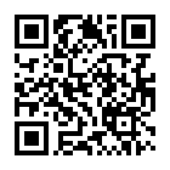

English · [Español](README.es.md)

# DTMF-Signer

A minimal, cheap, open-hardware Bitcoin signer that anyone can build. The
full board: a Raspberry Pi Pico, a small screen, five buttons, a microphone
and a piezo.
It talks to your wallet with telephone tones (DTMF) through
[ur-tones](https://github.com/ndssigner/ur-tones), through the air or by
cable. No camera, no USB data, no secure element and no storage: the seed
lives in memory only while you sign. From the
[NDS-Signer](https://github.com/ndssigner/nds-signer) project.

**The key idea:** the seed arrives as tones, made by ur-tones on an offline
computer, and **is never shown, on any channel**: only its fingerprint.
From there, you choose: keep everything on audio, for the strongest air
gap, or drive it from a vintage terminal over a serial port. DTMF-Signer
and ur-tones are designed to go together.

**Many ways to build it.** DTMF-Signer is a [specification](SPEC.md) that
can be built in many ways: from a Raspberry Pi Pico, the reference, down to
parts recovered from a scrapyard (an 8-bit microcontroller, a DTMF decoder
chip from an old telephone), knowing what each build gives up and how long
it takes. The [catalog](docs/catalog.md) lists the capabilities and the
profiles that combine them. The prototype uses a Pico (RP2040); the Pico 2
comes later.

> **Status: design stage.** There is no firmware or hardware yet. This
> repository holds the specification and its catalog (in English and
> Spanish), and the Pico hardware specification and the risk analysis (in
> Spanish for now). Do not use it with funds.

## Motivation

- **A signer for everyone.** It works on its own, with any phone or computer
  that can play and hear sound. No camera, no special cable, no app store.
- **Low cost.** About US$13 in parts for the basic board (an estimate),
  roughly a third of a signer that reads QR codes with a scanner module.
- **Easy, foolproof DIY.** Plug a Pico into a ready-made board, with no
  soldering, or wire common modules on a breadboard. Generic parts you can
  buy anywhere: the reference decodes the tones in software, so it needs no
  hard-to-find DTMF decoder chips. A slower build can use one salvaged from
  an old telephone.
- **Against supply-chain attacks and fake entropy.**
  - In October 2026, Ledger devices sold through resellers turned out to
    carry a hidden implant that read the recovery phrase from the screen
    during setup and sent it out over the mobile network; losses are
    estimated in the tens of millions of dollars
    ([CoinDesk](https://www.coindesk.com/tech/2026/10/13/ledger-says-spy-chip-inside-cryptobilis-ledger-devices-transmitted-wallet-keys-over-mobile-network)).
    Here you build the signer yourself from generic parts, the
    microcontroller is one you bought, flashed and can pull out of its
    socket, and every part of the board is open and in plain sight. And
    the seed is never shown on its screen: an implant reading it would
    find nothing to steal.
  - Also in 2026, a build error in Coldcard's firmware made it generate
    seeds from a weak software fallback instead of its hardware random
    number generator, and wallets created that way were swept
    ([crypto.news](https://crypto.news/coldcard-firmware-bug-drains-38-million-bitcoin/)).
    DTMF-Signer never generates seeds, and its signatures use deterministic
    nonces: it has no random number generator that could fail.

It also has **no black boxes** (no camera or QR module with closed
firmware: the whole path of the signal, from the microphone to the decoder,
is our own code), and it **likes old machines**: a vintage computer or
calculator can lend it a screen and a keyboard over a serial port.

## How it works

```
  wallet + ur-tones tool               DTMF-Signer
 ┌──────────────────────┐   tones   ┌───────────────────────┐
 │ unsigned PSBT  ──────┼─────────► │ microphone → decoder  │
 │                      │           │ screen + 5 buttons    │
 │ signed PSBT  ◄───────┼───────────┤ piezo ← tone encoder  │
 └──────────────────────┘   tones   └───────────────────────┘
```

1. The seed arrives as tones, encrypted with a PIN. The PIN is typed on the
   signer and never played. A passphrase, if you use one, comes by cable or
   is typed on the signer.
2. The signer shows the seed's fingerprint, to check it is the right one.
   The seed itself is never shown.
3. The unsigned PSBT arrives as tones.
4. The signer shows every output, amount and fee on its screen. You page
   through all of them, and hold a button to sign.
5. The signed PSBT goes back as tones.

Unplug it, and the seed is gone. From step 3 on, the PSBTs can travel as
tones, or through a vintage terminal over the serial port: your choice.

## Everyday use

1. Generate the seed outside the signer: with dice, or with another wallet
   you trust.
2. On an **offline computer**, the ur-tones web tool turns it into tones,
   protected by a **PIN of 12 characters or more** (it can make one up for
   you), and saves them as a **WAV** file.
3. Write the PIN down on paper or keep it in a password manager, **always
   apart from the WAV**.
4. Keep the WAV on an **audio player with no internet connection**, such as
   an MP3 player.
5. To sign: plug the player **by cable** into the signer's input jack and
   play the WAV. Type the PIN on the signer and check the fingerprint.
6. Then sign: PSBTs come and go through the air with your wallet, or
   through a vintage terminal.

The WAV is an encrypted copy of your seed: whoever gets it can try PINs
offline, so make the PIN long. And it **must not be your only backup**:
players break. Keep the seed itself some other way too (paper, metal,
[SeedCraft](https://github.com/ndssigner/seedcraft)…).

## The basic board

| Part | What for |
|---|---|
| Raspberry Pi Pico 2 in a socket | The microcontroller. You buy it and flash it |
| 1.3" OLED, 128 × 64 | Reviewing what you sign, entering PIN and passphrase |
| 5-button pad | Moving around, typing, confirming |
| Microphone and piezo | Tones through the air |
| Input-only audio jack | A cable channel for sensitive data |
| USB-C, power only | No data lines at all |

Optional ports come as **unpopulated footprints**, for whoever wants them:
RS-232 or TTL serial, PS/2 keyboard, black-and-white composite video, line
out, batteries, and a header with the free GPIO pins.

## Security in brief

- **The seed is never shown.** Not on the screen, the video output, the
  serial port or the audio. Only its fingerprint.
- **Stateless.** The seed lives in memory only. Nothing is written to flash.
  Unplugging, switching off or leaving it idle wipes it.
- **PIN and passphrase never go through the air.** Sensitive data comes by
  cable or is typed on the signer, and never leaves it, on any channel.
- **You review it on the signer.** Every output is shown on its own screen,
  and nothing is signed without its physical button.
- **No random number generator to get wrong.** Signatures use deterministic
  nonces (RFC 6979, BIP 340).
- **No secure element, by design.** There is nothing to extract when it is
  off.
- **Buying ties you to Bitcoin.** Any order for a ready-made board leaves
  your name and address in someone's database. Generic parts bought
  separately for the breadboard version are the most private path.

The whole analysis, by distribution format and by use, is in
[`docs/analisis-riesgos.md`](docs/analisis-riesgos.md) (Spanish).

## Ways to build it (planned)

- **Breadboard + bill of materials**, with common off-the-shelf modules.
- **Perfboard:** the same modules soldered onto a prototyping board laid out
  like a breadboard, with the Pico and the screen on socket headers. The
  breadboard layout carries over as is. Sturdier and portable, with no PCB
  to order.
- **"Shell" PCB:** factory-assembled, without the Pico or the screen. You buy
  those yourself, flash the Pico and plug them in.
- **The same PCB with the Pico and the screen in their sockets**, the Pico
  unflashed, for convenience. Reflash it before use.
- **A through-hole PCB** to order bare and solder by hand.

## Roadmap

- [x] Hardware-independent specification and capability catalog
- [ ] Core firmware and a computer build, tested with ur-tones recordings
- [ ] Software tone decoder on the Pico reference, tested with ur-tones
- [ ] Schematic, breadboard and perfboard guides, and bill of materials
- [ ] Two PCB layouts: SMD (factory-assembled) and through-hole
- [ ] Simulation of the analog stages and the firmware
- [ ] Firmware: audio, ur-tones, PSBT, signing, screens
- [ ] Serial protocol for vintage terminals
- [ ] Porting guide: an invitation to other platforms
- [ ] Independent review

## Notice

DTMF-Signer is an experimental design and is offered as is, without any
warranty. There is no working device yet, and no one independent has
reviewed it. We are not liable for any loss of funds or any other harm, nor
for the use anyone makes of this design.

## In this repository

- [`SPEC.md`](SPEC.md) ([Spanish](docs/es/especificacion.md)): the
  specification: what every build must do, whatever it is made of.
- [`docs/catalog.md`](docs/catalog.md) ([Spanish](docs/es/catalogo.md)): the
  capabilities and the profiles that combine them.
- [`docs/hardware-minimo.md`](docs/hardware-minimo.md): the hardware
  specification of the full Pico board: pins, audio, screens, distribution
  formats (Spanish).
- [`docs/analisis-riesgos.md`](docs/analisis-riesgos.md): the risk analysis:
  supply chain, buyer privacy, firmware, use and physical threats (Spanish).
- [`CONTRIBUTING.md`](CONTRIBUTING.md): how to propose changes, add to the
  catalog or port DTMF-Signer.

## Sister projects

- [NDS-Signer](https://github.com/ndssigner/nds-signer): an air-gapped
  signer for the Nintendo DSi, signing PSBTs from QR codes or tones.
- [ur-tones](https://github.com/ndssigner/ur-tones): PSBTs and seeds as
  telephone tones, by cable or through the air.
- [SeedCraft](https://github.com/ndssigner/seedcraft): a seed kept as the
  order of some objects, read back by hand or with a web tool.

## Donate

DTMF-Signer is free and has no funding. Donations help keep it going:

<table>
<tr><td align="center"><br><b>Bitcoin</b><br><code>bc1qx5snc0wlc8cg9gwxhyx27y6pkru8rnngyq7uja</code></td>
<td align="center"><br><b>Lightning</b><br><code>ndssigner@coinos.io</code><br><sub>LNURL (for wallets without Lightning addresses):<br><code>LNURL1DP68GURN8GHJ7CM0D9HX7UEWD9HJ7TNHV4KXCTTTDEHHWM30D3H82UNVWQHKUERNWD5KWMN9WGQ8XE42</code></sub></td></tr>
</table>

The same addresses as [NDS-Signer](https://github.com/ndssigner/nds-signer#donate).

## License

Not decided yet. The hardware is planned under
[CERN-OHL-S v2](https://ohwr.org/cern_ohl_s_v2.txt).
