# Las pantallas

Cómo se ve la versión de la Pico y cómo se navega por ella, en su OLED de
128 × 64 con cinco botones. Las imágenes no son fotos de la placa: salen del
propio código del firmware ejecutado en un ordenador, píxel a píxel, solo con
datos de prueba (la semilla 00…00, PIN `TEST`, passphrase `Ab 1!`). Para
generarlas de nuevo tras un cambio:

```
cmake --build build --target screens
python3 tools/render_screens.py build/tests/c/screens docs/images/screens
```

## Los botones

| Botón | Qué hace |
| :--- | :--- |
| ▲ ▼ | Moverse por menús, páginas y tarjetas |
| ◀ ▶ | Cambiar un ajuste; moverse en el selector; ◀ vuelve atrás en casi todas las pantallas |
| OK | Elegir, continuar, añadir un carácter |
| OK mantenido (1,5 s) | Terminar el PIN o la passphrase; firmar, en la última tarjeta de la revisión |
| ◀ mantenido (3 s) | **Borrado de emergencia**, en cualquier pantalla |

La fila de abajo de casi todas las pantallas, bajo una línea de puntos, dice
qué hace cada botón ahí. La pantalla va girada 180 grados por defecto, como
la monta la protoboard.

## Al encender

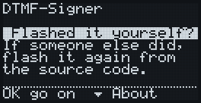

Cada vez que arranca, el firmador pregunta si lo has grabado tú. Un aparato
tan barato puede llegar como regalo, y uno que ha grabado otra persona puede
llevar cualquier cosa. Si no lo grabaste tú, vuelve a grabarlo desde el
código fuente (el repositorio está en las páginas de About). OK sigue al
menú de inicio, ▼ abre About.

Un firmware que quiera engañarte podría mostrar esta misma pantalla, o
ninguna: el aviso es para quien recibe un aparato honrado y debe conocer la
costumbre. Lo que protege es grabarlo desde BOOTSEL, porque el código de
arranque del RP2040 está en ROM y no se puede reescribir.

### About

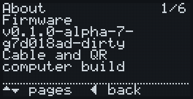
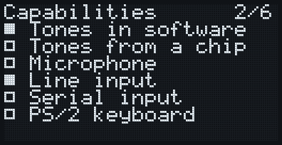
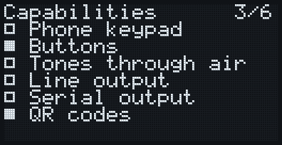
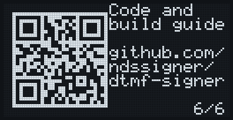

La versión del firmware (como la describió git al compilarlo), su perfil y
su hardware; luego cada capacidad de [el catálogo](catalogo.md), con la
casilla llena si esta compilación la tiene y vacía si la tendría otro
hardware u otra compilación; luego el repositorio como código QR. ▲ ▼ pasan
las páginas, ◀ vuelve atrás.

## Cargar la semilla

### El menú de inicio

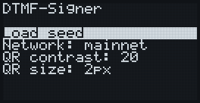

▲ ▼ mueven la selección y OK elige. `Load seed` empieza a escuchar. Los
ajustes muestran su valor entre flechas y cambian con ◀ ▶: la red (que
también se ve arriba a la derecha), el contraste de los QR y su tamaño (2 px
por módulo, o 1 px para códigos más grandes). `About` abre las páginas de
arriba.

### Escuchando

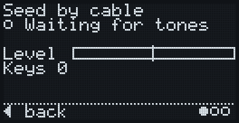
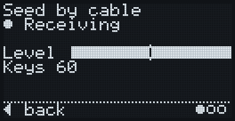

Reproduce los tonos de la semilla por el cable de audio. El título dice qué
espera el firmador. La segunda fila dice lo que llega: `Waiting for tones`,
o `Receiving` mientras se oyen teclas. La barra de nivel muestra con qué
fuerza llegan los tonos, con una marca a partir de la cual se leen bien
(unos -40 dBFS en la protoboard): sube el volumen hasta pasarla. Las teclas
se van contando; las de una semilla se cuentan, nunca se muestran. Si la
placa llega a perder audio, `lost` dice cuánto. Los puntos de abajo a la
derecha son los pasos de cargar una semilla. ◀ vuelve al inicio.

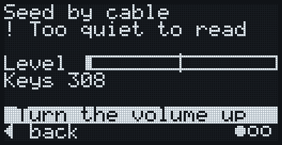
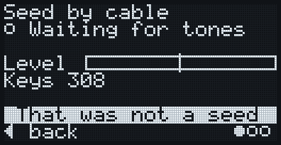

`Too quiet to read` quiere decir que llega sonido pero no se puede leer
ninguna tecla, y `Turn the volume up` dice qué hacer; también sale cuando se
pierde un cuadro con los tonos demasiado flojos. `That was not a seed`
quiere decir que ha llegado un cuadro de otra cosa (una PSBT, por ejemplo);
la escucha sigue.

### El PIN

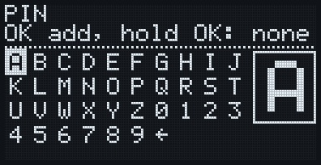
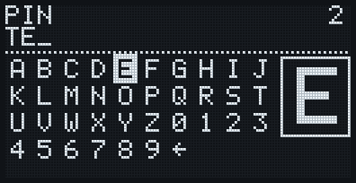

La semilla llega cifrada con un PIN. Las flechas se mueven por las letras y
los dígitos, dando la vuelta por los bordes; OK añade el carácter y el cursor
se queda donde está, así que una letra repetida es OK, OK. El recuadro de la
derecha muestra el carácter elegido tres veces más grande. La casilla de la
flecha, al final, borra el último carácter; con el PIN vacío vuelve atrás.
Mantén OK para terminar (sin escribir nada: sin PIN). El PIN se ve en claro:
solo lo ve quien tiene el firmador en la mano.

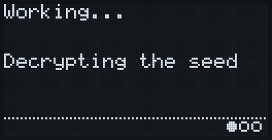

`Working...` dice qué está haciendo el firmador (descifrar la semilla,
derivar la cartera, comprobar una PSBT, firmar), unos segundos en el RP2040.

### Huellas y passphrase

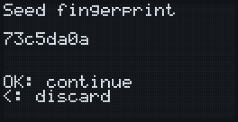

La huella de la semilla, en grande: ¿es la misma que la del emisor? Un PIN
equivocado da un error o una huella distinta. OK continúa, ◀ descarta la
semilla.

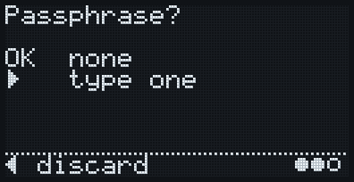

OK para no usar passphrase, ▶ para escribir una.

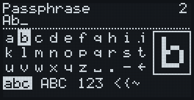
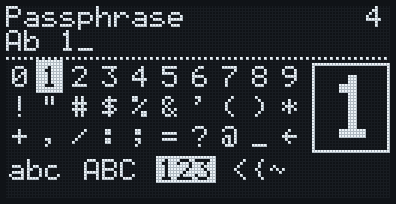

El selector de la passphrase funciona como el del PIN, en cuatro páginas de
ASCII imprimible: `abc`, `ABC`, `123` (dígitos y los símbolos más usados) y
`<{~` (el resto). Bajando desde la última fila se pasa a la página siguiente
y subiendo desde la primera a la anterior; las pestañas de abajo dicen dónde
estás. El espacio, el `.` y el `-` están en las dos páginas de letras, y la
casilla de borrar en la misma esquina de todas. Solo ASCII, a propósito: lo
explica [la especificación de hardware](../hardware-minimo.md), en lo que
dice de la passphrase.

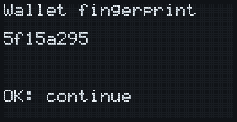

La huella de la cartera final, con la passphrase: ¿es la misma en la cartera
del ordenador? Una passphrase con una letra mal da otra cartera válida y
vacía: este número es la comprobación.

## La cartera

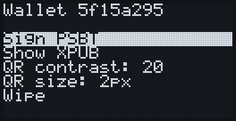

La cartera está cargada; su huella y la red están en el título. `Sign PSBT`
empieza a escuchar una PSBT, `Show XPUB` muestra la cuenta como un QR
animado, `Wipe` lo borra todo (como el borrado de emergencia).

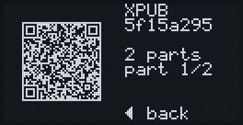

La xpub para la cartera de solo lectura (Sparrow, por ejemplo). La columna
derecha da el número de partes, cuál está en pantalla (de 1 a N, y vuelta a
empezar) y, tras la primera vuelta, `looping`. ◀ vuelve atrás. El QR usa su
propio ajuste de contraste.

## Firmar

### Recibir la PSBT

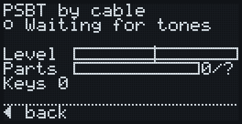
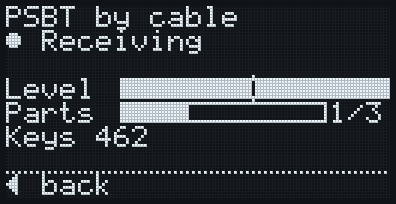

Como con la semilla, más una barra de las partes recibidas de las
necesarias. Que falten partes no es problema: la codificación fountain sirve
con cualquiera de ellas.

### La revisión

La revisión es una fila de tarjetas: ▲ ▼ para moverse, ◀ para cancelar;
cada tarjeta dice arriba a la derecha dónde estás.

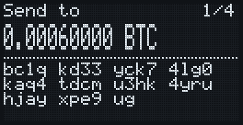
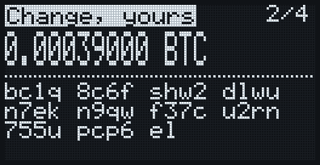

Una tarjeta por salida. Arriba dice qué es: `Send to`, o, en vídeo inverso,
`Change, yours` o `To this wallet` (solo para salidas que el firmador ha
comprobado que son de esta cartera). Luego el importe con los 8 decimales,
el doble de alto, y la dirección completa en grupos de 4, que nunca se parte
entre tarjetas: compárala grupo a grupo con la de la cartera del ordenador.
La `g`, la `j`, la `p`, la `q` y la `y` bajan de la línea, para que la `g` y
la `q` no se confundan con el `9`.

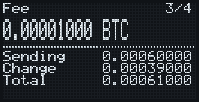

La comisión, y debajo lo enviado, el cambio y el total (enviado más
comisión). Si hay algo que avisar, viene una tarjeta `Check`: una comisión
alta, o entradas que no se van a firmar.

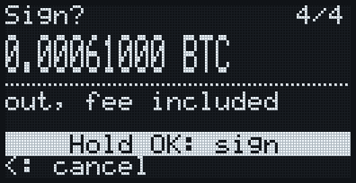

La última tarjeta: lo que sale, comisión incluida, y `Hold OK: sign`.
Firmar solo se ofrece aquí, después de ver todas las tarjetas; un toque que
llegó antes de que la revisión estuviera en pantalla no cuenta, y entonces
la barra dice `Tap OK, then hold OK`.

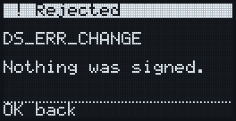

Una PSBT que el firmador no firma da `Rejected` y el motivo, aquí una salida
de cambio que dice ser de la ruta de esta cartera con una clave ajena
(`DS_ERR_CHANGE`). No se firma nada; OK vuelve atrás. Todas las pantallas de
error tienen la misma forma: qué ha pasado, en vídeo inverso, y qué revisar.

### La PSBT firmada

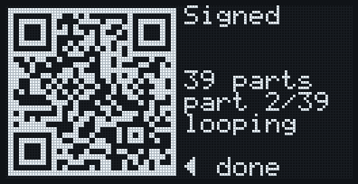

La PSBT firmada como QR animado, que lee la cartera del ordenador. ◀ cuando
ya se haya leído.

## El borrado de emergencia

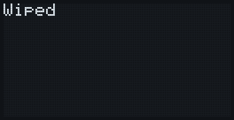

Mantén ◀ 3 segundos en cualquier pantalla: la semilla, el PIN, la passphrase
y todo lo derivado se borran, y la placa se reinicia.
