# The screens

How the Pico build looks and how you move through it, on its 128 × 64 OLED
with five buttons. The pictures are not photos of the board: they come from
the firmware's own code run on a computer, pixel for pixel, with test data
only (the seed 00…00, PIN `TEST`, passphrase `Ab 1!`). To make them again
after a change:

```
cmake --build build --target screens
python3 tools/render_screens.py build/tests/c/screens docs/images/screens
```

## The buttons

| Button | What it does |
| :--- | :--- |
| ▲ ▼ | Move through menus and pages |
| ◀ ▶ | Move in the picker; ◀ goes back on most screens |
| OK | Choose, continue, add a character |
| OK held (1.5 s) | Finish the PIN or the passphrase; sign, on the last page of the review |
| ◀ held (3 s) | **Emergency wipe**, on any screen |

The screen is turned 180 degrees by default, as the breadboard mounts it.

## Loading the seed

### The home menu

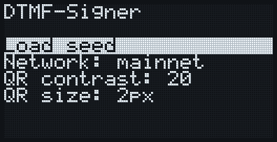

▲ ▼ move the highlight and OK chooses. `Load seed` starts listening. The
three settings change with OK: the network (mainnet or testnet), the QR
codes' contrast and their size (2 px per module, or 1 px for bigger codes).

### Listening

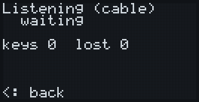
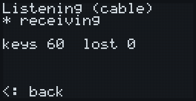

Play the seed's tones into the audio cable. The second row says what comes
in: `waiting` (nothing), `* receiving` (keys are being heard), and the keys
count up. A seed's keys are counted, never shown. `lost` counts audio the
board could not keep up with. ◀ goes back home.

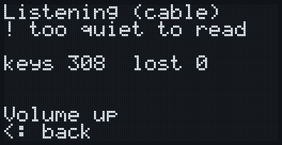
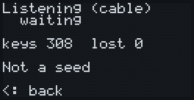

`! too quiet to read` means sound is arriving but no key can be read: turn
the volume up. `Not a seed` means a frame of something else arrived (a
PSBT, for example); listening goes on. When a frame is lost with its tones
too quiet, `Too quiet: volume up` is added below.

### The PIN

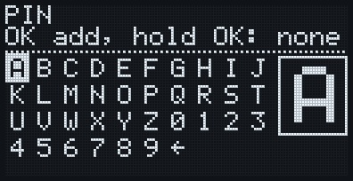
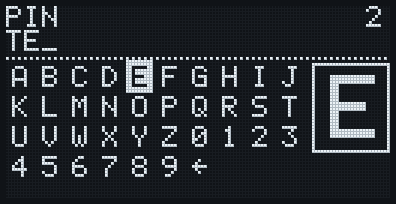

The seed arrives encrypted with a PIN. The arrows move over the letters and
digits, wrapping around the edges; OK adds the character and the cursor
stays, so a repeated letter is OK, OK. The box on the right shows the
chosen character three times larger. The arrow cell at the end deletes the
last character; on an empty PIN it goes back. Hold OK to finish (with
nothing typed: no PIN). The PIN is shown in the clear: only the person
holding the signer sees it.

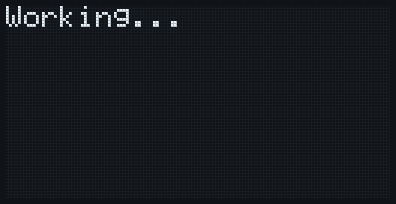

`Working...` comes up while the seed is decrypted and the wallet derived, a
few seconds on the RP2040.

### Fingerprints and passphrase

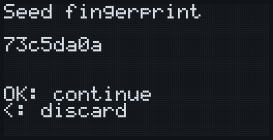

The seed's fingerprint: check it against the one the sender shows. A wrong
PIN gives an error or a different fingerprint. OK continues, ◀ discards the
seed.

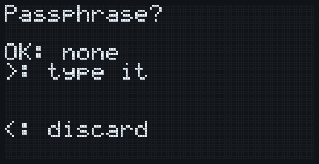

OK for no passphrase, ▶ to type one.

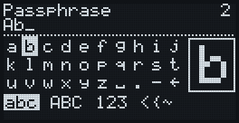
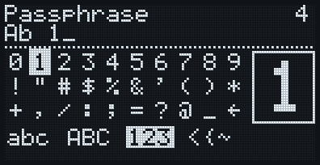

The passphrase picker works like the PIN's, over four pages of printable
ASCII: `abc`, `ABC`, `123` (digits and the commonest symbols) and `<{~`
(the rest). Down from the last row goes to the next page, up from the first
row to the previous one; the tabs at the bottom show where you are. Space,
`.` and `-` are on both letter pages, and the delete cell is in the same
corner of every page. Only ASCII, on purpose: see the passphrase notes in
[the hardware specification](hardware-minimo.md).

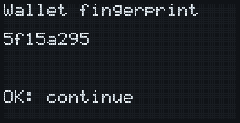

The final wallet's fingerprint, with the passphrase. A passphrase with one
letter wrong gives another valid, empty wallet: this number is the check.

## The wallet

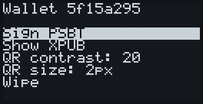

The wallet is loaded. `Sign PSBT` starts listening for a PSBT, `Show XPUB`
shows the account as an animated QR code, `Wipe` clears everything (as the
emergency wipe does).

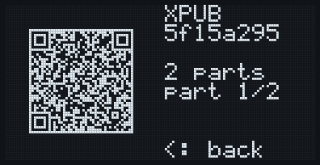

The xpub for the watch-only wallet (Sparrow, for example). The right column
gives the number of parts, which one is on the screen (counting 1 to N and
starting over) and, after the first pass, `looping`. ◀ goes back. The QR
code uses its own contrast setting.

## Signing

### Receiving the PSBT

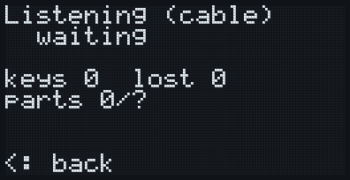
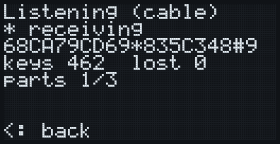

As for the seed, plus the last keys heard (a PSBT is public) and the parts
received out of those needed. Missing parts are no problem: the fountain
code takes any of them.

### The review

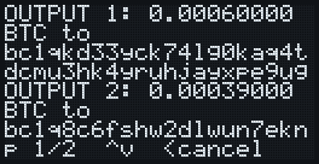
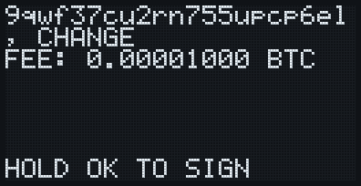

Every output with its amount and its full address, the change marked as
`CHANGE` only if it really belongs to this wallet, and the fee. ▲ ▼ turn
the pages; ◀ cancels. Signing is offered only on the last page, once every
page has been seen: hold OK there. With a single page, the screen first
says `Tap OK, then hold OK`.

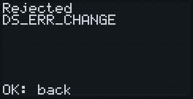

A PSBT the signer will not sign gives `Rejected` and the reason, here a
change output that claims this wallet's path with a foreign key
(`DS_ERR_CHANGE`). Nothing is signed; OK goes back.

### The signed PSBT


The signed PSBT as an animated QR code, read by the wallet on the computer.
◀ when it has been read.

## The emergency wipe


Hold ◀ for 3 seconds on any screen: the seed, the PIN, the passphrase and
everything derived are cleared, and the board restarts.
