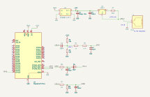

[English](README.md) · Español

# Centralita (PEX) en protoboard

El DTMF-Signer más barato: una Raspberry Pi Pico, un puñado de piezas y un
teléfono de tonos antiguo. El teléfono es toda la interfaz: el firmador
alimenta su línea, te habla por el auricular, oye sus teclas y oye los tonos
de tu cartera por el micrófono del auricular. Sin pantalla ni botones. El
firmware es el `DS_FIRMWARE=PEX` del port de la Pico
([cómo compilarlo, cargarlo y usarlo](../../ports/pico/README.es.md#la-centralita-pex));
el perfil es
[`PROFILE-PHONE`](../../docs/es/catalog.md#profile-phone--centralita-phone-exchange-pex).

**Nunca lo conectes a una roseta de la red telefónica real:** esa línea
lleva hasta 48 V, y unos 90 V de alterna cuando suena.

**Estado:** diseñado y funcionando en protoboard. El esquema está dibujado
en KiCad ([`kicad/pex.kicad_sch`](kicad/pex.kicad_sch)) y la disposición en
DIY Layout Creator, con una plantilla imprimible; la versión en placa
perforada está por hacer. Esta disposición separa las piezas de la
protoboard que se probó, y no se ha montado tal cual. No lo uses con
fondos.

## Piezas

La lista de piezas es [`bom.csv`](bom.csv): una Pico, una protoboard de
tamaño completo, un módulo elevador de 5 a 12 V (MT3608), un LM317, un
conector RJ11, una docena de resistencias y condensadores, y cualquier
teléfono de tonos con su auricular y su cable telefónico. Sin pantalla ni
botones cuesta menos que [Cable y QR](../breadboard/README.es.md), y los
teléfonos de tonos de segunda mano son fáciles de encontrar.

## El circuito

- **La alimentación de la línea:** el LM317 mantiene 1,25 V en la de 51 Ω,
  así que por la línea pasan unos 24,5 mA haya lo que haya en ella, que es lo
  que espera un teléfono. Un cortocircuito no hace daño. Con la línea abierta
  hay unos 11 V; un teléfono descolgado la deja en 6 a 8 V.
- **Oír la línea (GP27):** el 100 nF deja pasar los tonos y bloquea la
  continua de la línea; luego, la entrada de línea de siempre.
- **Hablar por la línea (GP15):** PWM, suavizado por la de 1 kΩ y el de
  10 nF, y acoplado a la línea por el de 10 µF, con su + hacia la línea.
- **El gancho (GP28):** el divisor 47k/10k lleva la tensión de la línea al
  rango del ADC (cerca de 1 V descolgado, cerca de 2 V colgado); el 100 nF le
  quita los tonos.
- **El teléfono** se enchufa al conector RJ11 con su propio cable
  telefónico; la línea son los dos contactos centrales del conector.

## Disposición

La disposición es [`dtmf-signer-pex.diy`](dtmf-signer-pex.diy), para
[DIY Layout Creator](https://github.com/bancika/diy-layout-creator) 6.8 o
posterior (gratuito), y su plantilla imprimible es
[`template-es.pdf`](template-es.pdf) ([`template-en.pdf`](template-en.pdf)
en inglés): imprímela al 100 %, comprueba que su barra mide 100 mm, recorta
la placa por el contorno marcado con tijeras y pégala en la placa como en
[Cable y QR](../breadboard/README.es.md#plantilla-imprimible). El módulo
elevador y el conector RJ11 están dibujados al lado, fuera de la placa; en
la placa, cada cable que va a ellos lleva su nombre en el borde.
[`tools/check_diy.py`](../../tools/check_diy.py) lee la disposición y
muestra qué conecta cada pieza.

La protoboard va en horizontal con la **Pico a la izquierda** y el USB hacia
el borde izquierdo. Las filas van de 1 (extremo derecho) a 63 (extremo
izquierdo); las columnas a–e son la mitad de arriba y f–j la de abajo.

**La Pico** va sobre el canal en las **filas 44 a 63**, con el USB en la 63:
pines 21–40 en la columna **d** (pin 21 en d44, pin 40 en d63) y pines 1–20
en la **i** (pin 1 en i63, pin 20 en i44).

| Pin | Señal | Agujero |
| --- | --- | --- |
| 40 | VBUS (5 V del USB) | d63 |
| 36 | 3V3 (OUT) | d59 |
| 34 | GP28 (gancho) | d57 |
| 33 | AGND | d56 |
| 32 | GP27 (entrada de línea) | d55 |
| 23 | GND | d46 |
| 20 | GP15 (salida de audio) | i44 |
| 18 | GND | i46 |

**Raíles:**

| Raíl | Qué lleva | Puente |
| --- | --- | --- |
| Arriba exterior | **3V3** | a59 → raíl |
| Arriba interior | **GND** | a46 → raíl, y a56 → raíl (AGND) |
| Abajo interior | **Línea A**, hasta 12 V: nunca 3V3 | |
| Abajo exterior | **GND** | j46 → raíl |

Todo lo que va a la línea del teléfono se pincha en el raíl de abajo
interior.

**La alimentación de la línea** (mitad de abajo, filas 6–11):

| Pieza | Agujeros | Notas |
| --- | --- | --- |
| **LM317** | f11, f10, f9 | con la cara impresa hacia ti (el borde de abajo): de izquierda a derecha ADJ (f11), OUT (f10), IN (f9) |
| Resistencia de **51 Ω** | i10 – raíl de abajo interior | de OUT a la línea A |
| Puente | j11 → raíl de abajo interior | ADJ a la línea A |
| Electrolítico de **100 µF** | + en i9, − en i6 | la fila 9 son los 12 V |
| Condensador de 100 nF | g9 – g6 | |
| Puente | j6 → raíl de abajo exterior | la fila 6 es GND |

**El módulo elevador** va fuera de la placa, debajo de las filas 1–9, con
cuatro cables:

| Contacto | Agujero |
| --- | --- |
| **OUT+** del MT3608 | j9 (12 V) |
| **OUT−** del MT3608 | raíl de abajo exterior, fila 7 |
| **IN+** del MT3608 | a63 (VBUS), rodeando el extremo izquierdo de la placa |
| **IN−** del MT3608 | raíl de abajo exterior, fila 1 |

**El teléfono:** los dos contactos centrales del conector RJ11: uno al
**raíl de abajo interior** (línea A, fila 15) y el otro al **raíl de abajo
exterior** (línea B, fila 17). Si el teléfono no suena y la línea se queda
en unos 11 V con el auricular descolgado, inviértelos.

**Entrada de línea** (mitad de arriba, filas 28–42):

| Pieza | Agujeros | Notas |
| --- | --- | --- |
| Puente | j30 → raíl de abajo interior | la línea A a la fila 30 |
| Condensador de 100 nF | f30 – e30 | sobre el canal |
| Resistencia de 10 kΩ | a30 – raíl de arriba exterior, fila 28 | |
| Resistencia de 10 kΩ | b30 – raíl de arriba interior, fila 32 | la fila 30 de arriba queda a 1,65 V |
| Resistencia de 1 kΩ | c30 – c36 | |
| Resistencia de 4,7 kΩ | d36 – d42 | |
| Condensador de 10 nF | a42 – raíl de arriba interior, fila 42 | |
| Puente | b42 → b55 | a GP27 |

**El gancho** (mitad de arriba, filas 36–40):

| Pieza | Agujeros | Notas |
| --- | --- | --- |
| Puente | j38 → raíl de abajo interior | la línea A a la fila 38 |
| Resistencia de **47 kΩ** | f38 – e38 | sobre el canal |
| Resistencia de 10 kΩ | a38 – raíl de arriba interior, fila 40 | |
| Condensador de 100 nF | b38 – raíl de arriba interior, fila 36 | |
| Puente | c38 → c57 | a GP28 |

**Salida de audio** (mitad de abajo, filas 40–45):

| Pieza | Agujeros | Notas |
| --- | --- | --- |
| Resistencia de 1 kΩ | h44 – h40 | la fila 44 de abajo es GP15 |
| Condensador de 10 nF | j40 – raíl de abajo exterior, fila 40 | |
| Electrolítico de 10 µF | − en i40, + en el raíl de abajo interior, fila 45 | la banda (−) hacia la fila 40 |

## Montaje, paso a paso

Comprueba después de cada paso; los valores son los de un montaje que
funciona.

1. **La Pico y los raíles.** Sin USB, en ohmios: cada raíl continuo de punta
   a punta, sin cortocircuito entre los raíles de arriba ni entre los de
   abajo.
2. **Entrada de línea y salida de audio.** Con USB: unos **1,65 V** en d30.
3. **Ajusta el elevador antes de conectar su salida.** Un MT3608 nuevo puede
   venir a 16 V o más. Conecta solo su entrada (IN+ a a63, IN− al raíl de
   abajo exterior), deja OUT+ y OUT− sueltos, enchufa el USB y gira su
   potenciómetro hasta **12,0 V** entre OUT+ y OUT−. Desenchufa.
4. **La alimentación de la línea.** Sin USB, sin cortocircuito entre h9 y el
   raíl de abajo exterior. Con USB y sin teléfono: unos 12 V en h9 y unos
   11 V en el raíl de abajo interior; el polímetro en mA del raíl de abajo
   interior al de abajo exterior marca **22–25 mA**.
5. **El gancho.** Con USB y sin teléfono, unos 1,9 V en d38 (nunca más de
   3,3 V); después, el puente c38 → c57.
6. **El teléfono.** Con el auricular descolgado, la línea a **6–8 V**;
   colgado, unos 11 V. Pulsa una tecla: oyes su tono por el auricular.

Después carga el firmware y un paquete de voz
([cómo](../../ports/pico/README.es.md#paquetes-de-voz)): al descolgar, el
firmador te saluda.

## Uso

- **Aliméntalo con un cargador USB o un power bank,** nunca con un ordenador.
- **Descuelga** y sigue lo que te dice. Para colgar un momento (el colgado
  corto que firma y borra), aprieta el pulsador del gancho menos de un
  segundo.
- **Mientras el auricular está pegado a tu cartera** no oyes al firmador; el
  LED de la Pico dice cómo va la recepción: un destello corto por tono, uno
  largo por cada parte que entra, y encendido fijo cuando ha llegado todo.

## Notas

- Probado en protoboard con sustitutos para un teléfono que había perdido su
  auricular (ver [qué está probado](../../ports/pico/README.es.md#qué-está-probado-centralita)):
  el diseño de arriba, con un teléfono completo, es el que hay que montar.
- El elevador puede pitar en el auricular; una resistencia de 10 Ω y un
  segundo 100 µF entre él y el LM317 lo filtran.
