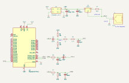

English · [Español](README.es.md)

# Phone Exchange (PEX) on a breadboard

The cheapest DTMF-Signer: a Raspberry Pi Pico, a handful of parts and an old
tone telephone. The telephone is the whole interface: the signer powers its
line, speaks to you in the earpiece, hears its keys, and hears your wallet's
tones through the handset's microphone. No screen and no buttons. The
firmware is the Pico port's `DS_FIRMWARE=PEX`
([how to build, flash and use it](../../ports/pico/README.md#the-phone-exchange-pex));
the profile is
[`PROFILE-PHONE`](../../docs/catalog.md#profile-phone--phone-exchange-pex).

**Never connect it to a socket of the real telephone network:** that line
carries up to 48 V, and about 90 V AC when it rings.

**Status:** designed and running on a breadboard. The schematic is drawn
in KiCad ([`kicad/pex.kicad_sch`](kicad/pex.kicad_sch)) and the layout in
DIY Layout Creator, with a printable template; the perfboard version is
still to come. This layout spreads out the parts of the breadboard that was
tested, and has not been built as it stands. Do not use it with funds.

## Parts

The parts list is [`bom.csv`](bom.csv): a Pico, a full-size breadboard, a
5 to 12 V boost module (MT3608), an LM317, an RJ11 socket, a dozen resistors
and capacitors, and any tone telephone with its handset and its telephone
cable. Without a screen and buttons it costs less than
[Cable and QR](../breadboard/README.md), and second-hand tone telephones
are easy to come by.

## The circuit

- **The line's power:** the LM317 holds 1.25 V across the 51 Ω, so about
  24.5 mA flow through the line whatever is on it, which is what a telephone
  expects. A short circuit does no harm. An open line sits at about 11 V; a
  telephone off the hook holds it at 6 to 8 V.
- **Hearing the line (GP27):** the 100 nF passes the tones and blocks the
  line's DC; then the usual line input.
- **Speaking into the line (GP15):** PWM, smoothed by the 1 kΩ and the
  10 nF, coupled into the line by the 10 µF, its + towards the line.
- **The hook (GP28):** the 47k/10k divider brings the line's voltage within
  the ADC's range (about 1 V off the hook, about 2 V on it); the 100 nF
  removes the tones from it.
- **The telephone** plugs into the RJ11 socket with its own telephone
  cable; the line is the socket's two centre contacts.

## Layout

The layout is [`dtmf-signer-pex.diy`](dtmf-signer-pex.diy), for
[DIY Layout Creator](https://github.com/bancika/diy-layout-creator) 6.8 or
later (free), and its printable template is
[`template-en.pdf`](template-en.pdf) ([`template-es.pdf`](template-es.pdf)
in Spanish): print it at 100 %, check that its bar measures 100 mm, cut
the board out along the outline marked with scissors and paste it on the
board as for [Cable and QR](../breadboard/README.md#printable-template).
The boost module and the RJ11 socket are drawn beside it, off the board;
on the board, each wire to them carries its name at the edge.
[`tools/check_diy.py`](../../tools/check_diy.py) reads the layout and
prints what each part connects.

The breadboard lies horizontally with the **Pico on the left**, its USB
towards the left edge. Rows run from 1 (right end) to 63 (left end);
columns a–e are the top half and f–j the bottom half.

**The Pico** straddles the channel on **rows 44 to 63**, USB at row 63:
pins 21–40 in column **d** (pin 21 at d44, pin 40 at d63) and pins 1–20 in
column **i** (pin 1 at i63, pin 20 at i44).

| Pin | Signal | Hole |
| --- | --- | --- |
| 40 | VBUS (5 V from the USB) | d63 |
| 36 | 3V3 (OUT) | d59 |
| 34 | GP28 (hook) | d57 |
| 33 | AGND | d56 |
| 32 | GP27 (line in) | d55 |
| 23 | GND | d46 |
| 20 | GP15 (audio out) | i44 |
| 18 | GND | i46 |

**Rails:**

| Rail | What it carries | Jumper |
| --- | --- | --- |
| Top outer | **3V3** | a59 → rail |
| Top inner | **GND** | a46 → rail, and a56 → rail (AGND) |
| Bottom inner | **Line A**, up to 12 V: never 3V3 | |
| Bottom outer | **GND** | j46 → rail |

Everything on the telephone's line plugs into the bottom inner rail.

**The line's power** (bottom half, rows 6–11):

| Part | Holes | Notes |
| --- | --- | --- |
| **LM317** | f11, f10, f9 | printed face towards you (the bottom edge): from left to right ADJ (f11), OUT (f10), IN (f9) |
| **51 Ω** resistor | i10 – bottom inner rail | from OUT to line A |
| Jumper | j11 → bottom inner rail | ADJ to line A |
| **100 µF** electrolytic | + at i9, − at i6 | row 9 is the 12 V |
| 100 nF capacitor | g9 – g6 | |
| Jumper | j6 → bottom outer rail | row 6 is GND |

**The boost module** lies off the board, below rows 1–9, with four wires:

| Pad | Hole |
| --- | --- |
| MT3608 **OUT+** | j9 (12 V) |
| MT3608 **OUT−** | bottom outer rail, row 7 |
| MT3608 **IN+** | a63 (VBUS), round the board's left end |
| MT3608 **IN−** | bottom outer rail, row 1 |

**The telephone:** the RJ11 socket's two centre contacts: one to the
**bottom inner rail** (line A, row 15), the other to the **bottom outer
rail** (line B, row 17). If the telephone stays silent and the line at
about 11 V with the handset lifted, swap them.

**Line in** (top half, rows 28–42):

| Part | Holes | Notes |
| --- | --- | --- |
| Jumper | j30 → bottom inner rail | line A to row 30 |
| 100 nF capacitor | f30 – e30 | across the channel |
| 10 kΩ resistor | a30 – top outer rail, row 28 | |
| 10 kΩ resistor | b30 – top inner rail, row 32 | row 30 at the top sits at 1.65 V |
| 1 kΩ resistor | c30 – c36 | |
| 4.7 kΩ resistor | d36 – d42 | |
| 10 nF capacitor | a42 – top inner rail, row 42 | |
| Jumper | b42 → b55 | to GP27 |

**The hook** (top half, rows 36–40):

| Part | Holes | Notes |
| --- | --- | --- |
| Jumper | j38 → bottom inner rail | line A to row 38 |
| **47 kΩ** resistor | f38 – e38 | across the channel |
| 10 kΩ resistor | a38 – top inner rail, row 40 | |
| 100 nF capacitor | b38 – top inner rail, row 36 | |
| Jumper | c38 → c57 | to GP28 |

**Audio out** (bottom half, rows 40–45):

| Part | Holes | Notes |
| --- | --- | --- |
| 1 kΩ resistor | h44 – h40 | row 44 at the bottom is GP15 |
| 10 nF capacitor | j40 – bottom outer rail, row 40 | |
| 10 µF electrolytic | − at i40, + at the bottom inner rail, row 45 | the stripe (−) towards row 40 |

## Building it, step by step

Check after each step; the numbers are those of a working build.

1. **The Pico and the rails.** Without USB, in ohms: each rail continuous
   end to end, no short between the top rails nor between the bottom ones.
2. **Line in and audio out.** With USB: about **1.65 V** at d30.
3. **Set the boost module before wiring its output.** A new MT3608 may come
   set to 16 V or more. Wire only its input (IN+ to a63, IN− to the bottom
   outer rail), leave OUT+ and OUT− loose, plug the USB and turn its
   potentiometer until **12.0 V** between OUT+ and OUT−. Unplug.
4. **The line's power.** Without USB, no short between h9 and the bottom
   outer rail. With USB and no telephone: about 12 V at h9 and about 11 V on
   the bottom inner rail; the meter in mA from the bottom inner rail to the
   bottom outer rail reads **22–25 mA**.
5. **The hook.** With USB and no telephone, about 1.9 V at d38 (never over
   3.3 V); then the jumper c38 → c57.
6. **The telephone.** With the handset lifted, the line at **6–8 V**; on the
   hook, about 11 V. Press a key: you hear its tone in the earpiece.

Then flash the firmware and a voice pack
([how](../../ports/pico/README.md#voice-packs)): on lifting the handset,
the signer greets you.

## Use

- **Power it from a USB charger or a power bank,** never from a computer.
- **Lift the handset** and follow what it says. To hang up for a moment (the
  hook flash that signs and wipes), press the hook switch for less than a
  second.
- **While the handset is held to your wallet** you cannot hear the signer;
  the Pico's LED tells how the reception goes: a short flash per tone, a long
  one per part taken, and on, steady, once it is all in.

## Notes

- Tested on a breadboard with stand-ins for a telephone that had lost its
  handset (see [what is tested](../../ports/pico/README.md#what-is-tested-pex)):
  the design above, with a whole telephone, is the one to build.
- The boost module can whine in the earpiece; a 10 Ω resistor and a second
  100 µF between it and the LM317 filter it.
